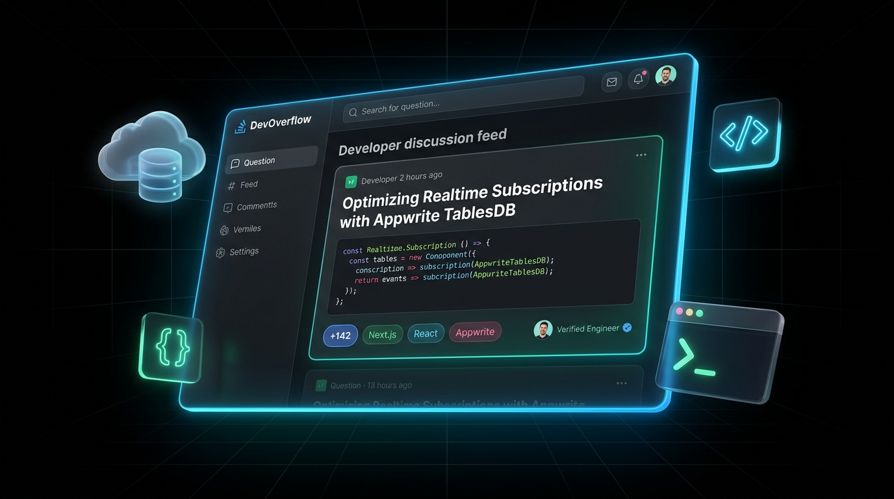
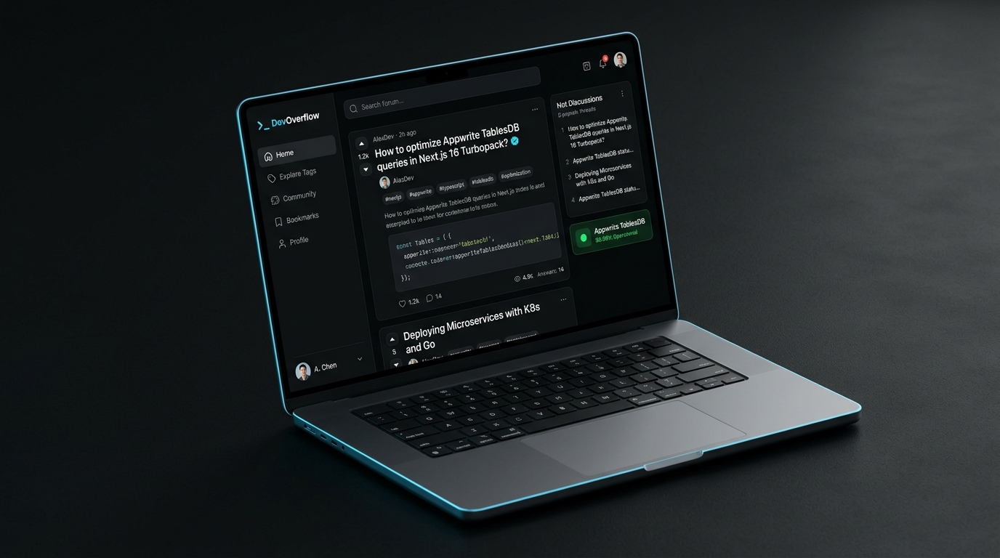
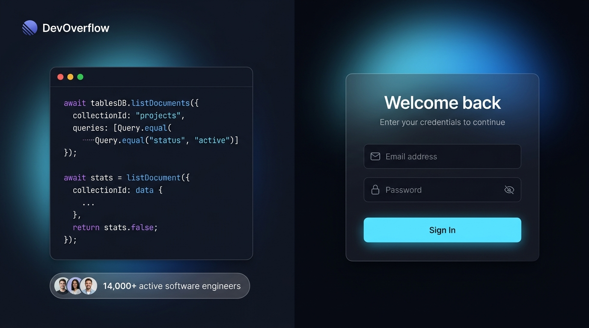
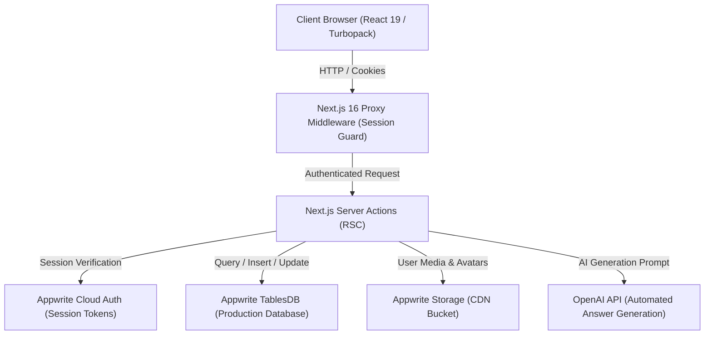

# DevOverflow — The Modern Developer Knowledge Network

<div align="center">



[-black?style=for-the-badge&logo=next.js)](https://nextjs.org/)
[](https://react.dev/)
[](https://appwrite.io/)
[](https://tailwindcss.com/)
[](https://www.typescriptlang.org/)
[](https://sgp.cloud.appwrite.io)

**DevOverflow** is a high-taste, real-time developer community and technical question-answering platform. Built from the ground up on **Next.js 16 (React 19)** and **Appwrite Cloud TablesDB**, it bridges the gap between the speed of modern social feeds and the structured depth of technical documentation.

[Explore Feed](http://localhost:3000) · [Architecture](#-system-architecture) · [Features](#-core-features) · [Appwrite Schema](#-appwrite-tablesdb-architecture) · [Getting Started](#-getting-started)

</div>

---

## 💡 The Purpose & Vision

Traditional engineering forums are rigid, slow, and visually dated. Developers spend hours searching through bloated pages when they need fast, clear answers, live code discussions, and peer review from verified engineers.

**DevOverflow** reimagines technical knowledge sharing with:
1. **The Flow of a Social Stream**: Fast, 3-column Twitter/X-style layout with micro-interactions, rich code previews, and responsive timelines.
2. **The Precision of Stack Overflow**: Threaded replies, reputation badges, upvote/downvote algorithms, syntax highlighting, and verified developer checkmarks.
3. **The Speed of Modern Cloud Infrastructure**: Instant queries via **Appwrite TablesDB**, HTTP-only SSR session security, and **Next.js 16 Turbopack** server actions.

---

## 📸 Product Showcases

### Real-Time Developer Feed & Thread Stream

*Edge-to-edge 3-column shell with active timeline tabs, interactive post composer, syntax-highlighted snippets, and real-time trending sidebar.*

---

### Bespoke Developer Authentication Experience

*Split-screen authentication screen featuring an interactive live Appwrite query terminal on the left and a glassmorphic login card with password reveal on the right.*

---

## ⚡ Core Features

### 1. 🧵 Fast Stream & Timeline Feed
- **3-Column Architecture**: Bounded desktop grid (`max-w-[1260px]`) featuring a left navigation rail, center stream (`max-w-[680px]`), and right widget sidebar.
- **Timeline Filtering**: Instant tab switching between `"For you"`, `"Latest"`, `"Unanswered"`, and `"Frequent"`.
- **Developer Micro-Composer**: Quick question prompt directly in the stream with code snippet shortcuts, `#tag` inserter, and markdown support.

### 2. 💬 Discussion Threads & AI Assistance
- **Interactive Action Bar**: Native copy-to-clipboard thread sharing with toast feedback, upvote/downvote counters, and bookmarking.
- **AI Answer Assistant**: Integrated OpenAI / ChatGPT helper that synthesizes automated solutions with code examples at the press of a button.
- **Syntax Highlighting**: Built-in Prism.js highlighting supporting over 20 languages (TypeScript, Python, Go, Rust, SQL, and more).

### 3. 🛡️ Native Appwrite Authentication & Sessions
- **Zero Third-Party Vendor Bloat**: Powered entirely by Appwrite Cloud Users & Sessions API.
- **Encrypted HTTP-Only Cookies**: Secure session token persistence across server and client components with automated redirect guards.
- **Context-Aware Navigation**: Universal `<SignedIn>` and `<SignedOut>` components with live user switcher and avatar indicators.

### 4. 🏆 Developer Reputation & Verified Badges
- **Reputation Engine**: Developers earn reputation points (`⚡ 150 rep`) based on answer upvotes and helpful community contributions.
- **Medal Badges**: Dynamic calculation of **Gold**, **Silver**, and **Bronze** badges displayed across user profiles and cards.
- **Verified Engineer Status**: Distinguish active developers with verified checkmarks and stack tags.

### 5. 🏷️ Trending Tech & Developer Directory
- **Explore Trends**: Ranked tech topics (`#1 Trending in Tech`) with discussion counts and technology descriptions.
- **Community Who to Follow**: Searchable directory of developers, filterable by reputation, join date, and active stack.
- **Saved Bookmarks**: Secure personal vault for saving critical solutions for future reference.

---

## 🏗️ System Architecture



---

## 🗄️ Appwrite TablesDB Architecture

DevOverflow is powered by Appwrite Cloud **TablesDB** (`6adcb48000343a1edbc5`) in the Singapore (`sgp.cloud.appwrite.io`) region.

### Collections & Schema Specifications

| Collection | Table ID | Purpose | Primary Attributes |
| :--- | :--- | :--- | :--- |
| **Users** | `users` | Developer accounts & profiles | `name`, `username`, `email`, `picture`, `bio`, `reputation`, `location`, `portfolioWebsite`, `joinedAt` |
| **Questions** | `questions` | Technical questions & threads | `title`, `content`, `author`, `tags`, `views`, `upvotes`, `downvotes`, `answers`, `createdAt` |
| **Answers** | `answers` | Community & AI replies | `content`, `author`, `question`, `upvotes`, `downvotes`, `createdAt` |
| **Tags** | `tags` | Technologies & topics | `name`, `description`, `questions`, `followers`, `createdOn` |
| **Interactions** | `interactions` | View counts & vote tracking | `user`, `action`, `question`, `answer`, `tags`, `createdAt` |

### Database Indexes for Fast Sub-50ms Queries
- `idx_users_account` & `idx_users_email`: Instant lookups during authentication.
- `idx_questions_author` & `idx_questions_views`: Ordered timeline feeds.
- `idx_answers_question`: Fast threaded answer rendering.
- `idx_tags_name`: Fast predictive search and hashtag grouping.

---

## 🛠️ Tech Stack Overview

| Layer | Technology | Description |
| :--- | :--- | :--- |
| **Framework** | Next.js 16.4.3 | Latest App Router with Turbopack and React 19 compatibility |
| **Database** | Appwrite TablesDB | Scalable relational tables database with sub-50ms indexing |
| **Auth** | Appwrite Sessions | HTTP-only encrypted session cookie authentication |
| **Object Storage** | Appwrite Storage | High-speed global CDN for avatars and code assets |
| **AI Integration** | OpenAI API | GPT-powered intelligent answer assistant |
| **Styling** | Tailwind CSS 3.3 | Pitch-black (`#000000`) and pure white (`#ffffff`) theme with sky blue accents |
| **Icons** | Lucide React | Razor-sharp micro-interaction icons |
| **Rich Text** | TinyMCE React | Dual-theme code editor with syntax sample support |
| **Syntax Highlighting** | Prism.js | Multi-language code syntax coloring |

---

## 🚀 Getting Started

### 1. Prerequisites
- **Node.js**: `v20.x` or `v22.x`
- **npm**: `v10.x` or higher
- An **Appwrite Cloud** account with TablesDB enabled

### 2. Installation & Setup

```bash
# Clone the repository
git clone https://github.com/Asaad-Siddiqui/Appwrite-Hack.git
cd Appwrite-Hack

# Install dependencies (React 19 peer resolution)
npm install --legacy-peer-deps
```

### 3. Environment Configuration

Create a `.env.local` file in the root directory:

```env
# Appwrite Cloud Configuration
NEXT_PUBLIC_APPWRITE_ENDPOINT=https://sgp.cloud.appwrite.io/v1
NEXT_PUBLIC_APPWRITE_PROJECT=6adcb0d2002b03e62588
APPWRITE_API_KEY=your_appwrite_api_key_here
APPWRITE_DATABASE_ID=6adcb48000343a1edbc5
NEXT_PUBLIC_APPWRITE_DATABASE_ID=6adcb48000343a1edbc5

# Server & AI Configuration
NEXT_PUBLIC_SERVER_URL=http://localhost:3000
OPENAI_API_KEY=your_openai_api_key_here
NEXT_PUBLIC_TINY_EDITOR_API_KEY=your_tinymce_key_here
```

### 4. Running the Development Server

```bash
npm run dev
```

Open [http://localhost:3000](http://localhost:3000) in your browser to explore the platform.

### 5. Production Build & Verification

```bash
# Compile optimized production bundle with Turbopack
npm run build

# Start production server
npm run start
```

---

## 🔒 Security & Performance Features

- **SSR Cookie Sessions**: Authentication tokens are stored exclusively in HTTP-only, secure, `SameSite=Strict` cookies.
- **Server Actions with Optimistic UI**: Instant vote updates and bookmark toggling without full-page reloads.
- **SVG Protection & Image Optimization**: Strict remote patterns configured in `next.config.js` with Content Security Policy headers.
- **Zero Unused Dependencies**: 100% lightweight native Appwrite SDKs (`node-appwrite` and `appwrite`).

---

## 📄 License

This project is licensed under the MIT License. Built with passion for the developer community and powered by **Appwrite TablesDB**.
